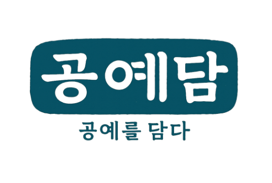

  

# 🏺 공예담 (Gongye-dam)

> **"공예를 담은 온기가 있는 이야기"**
>
> 공방 소품 큐레이션 및 이커머스 플랫폼

---

## 🔗 접속 정보
* **배포 URL**: [https://gongyedam.shop](https://gongyedam.shop)
* **테스트 계정**
    * **ID**: `admin`
    * **PW**: `admin1`

## 📝 프로젝트 소개
공예담은 공방 특유의 감성을 담은 소품을 소비자와 연결하는 **공예 전문 쇼핑몰**입니다.
단순한 판매를 넘어 작가의 철학이 담긴 공방 정보를 제공하고, 취향 기반의 검색과 커뮤니티(리뷰/팔로우) 기능을 제공합니다.

### 🎯 주요 타겟 및 가치
* **사용자**: 나만의 취향이 담긴 소품을 찾는 소비자
* **가치**: 파편화된 공방 정보를 하나로 모아 접근성을 높이고, 작가에게는 판로를 제공

---

## 🛠 기술 스택 (Tech Stack)

### **Frontend**
      

### **Backend**
   

### **Infrastructure & DevOps**
   

### **Tools & Collaboration**
    

## 🚀 채택 기술 및 상세 이유 (Technical Rationale)

### **Infrastructure & DevOps**
* : 인프라 구성 전체를 코드로 관리함으로써 AWS 리소스를 활용해 언제든 동일한 서버 환경을 자동 구축할 수 있는 가용성을 확보했습니다.
* : 컨테이너 기술을 도입하여 개발, 테스트, 운영 등 어떤 환경에서도 동일한 배포 명령어로 일관된 서비스를 제공할 수 있는 환경을 표준화했습니다.
* : 별도의 외부 툴 없이 GitHub Secret Key 관리만으로 보안성을 유지하며 CI/CD를 구현했습니다. 특히 수동 배포 시 번거로운 `Git Push -> 이미지 생성 -> 컨테이너 갱신` 과정을 자동화하여 개발 생산성을 높였습니다.

### **Frontend & Authentication**
* : 컴포넌트화를 통해 코드 재사용성을 극대화했습니다. 특히 레이아웃 시스템을 활용해 페이지 이동 시 콘텐츠 영역만 교체하는 방식을 취함으로써 불필요한 리소스 낭비를 줄였습니다.
*  : API 요청을 변수화하고 공통 설정을 적용하여 반복되는 통신 로직을 효율적으로 관리했습니다. 응답 데이터의 자동 JSON 변환 기능을 통해 클라이언트 측 코드를 대폭 간소화했습니다.
*  **(JSON Web Token)**: 토큰 기반 인증 시스템을 구축하여 서버의 세션 저장 부담을 줄이고, 서비스 확장 시에도 유연하게 대응할 수 있는 효율적인 인증 구조를 실현했습니다.

---
## 📂 프로젝트 구조 (Architecture)
> 여기에 프로젝트 구조도 이미지를 삽입하세요. (예: ``)

## 👥 팀원 역할 분담

| 이름          | 담당 브랜치 | 담당 역할           | 주요 구현 기능                                             |
|:------------| :--- |:----------------|:-----------------------------------------------------|
| **이승운**     | `feature-auth` | 팀장, 배포, 각종 문서작성 | **인프라 구축 및 배포(AWS, Terraform)**, 회원가입/로그인, 공방 관리 시스템 |
| **김효중**     | `feature-product` | 부팀장, 전제 구조구상    | 메인/목록/상세 페이지, **Toss 결제 연동**, 상품 필터링                 |
| **서지선**     | `feature-personal` | 일정관리, 디자인       | 마이페이지, 결제/배송지 관리, 회원 정보 처리                           |
| **조현영**     | `feature-review` | 회의록 작성, 디자인     | 리뷰 시스템(CRUD), 리뷰 이미지 및 댓글 관리 기능                      |
| **채상진**     | `feature-admin` | 디자인             |  관리자 페이지, 입점 관리, 주문 및 회원 권한 제어                       |

---

## 📅 개발 기간
* **기획 및 설계**: 2025.10.01 ~ 2025.10.17
* **기능 개발**: 2025.10.18 ~ 2025.12.09
* **문서화 및 안정화**: 2025.12.10 ~ 2025.12.26

---
## 🖥️ 페이지별 기능 소개 (Features by Page)

 
<b>🔐 인증 및 계정 (Auth & Account) - 펼쳐보기</b>

회원가입 페이지

로그인 페이지
 

 
<b>🛍️ 쇼핑 및 상품 (Shopping & Products) - 펼쳐보기</b>

메인 페이지

상품 목록 페이지

상품 상세 페이지
 

 
<b>👤 마이페이지 (My Page) - 펼쳐보기</b>

회원정보 관리

주문 결제 관리

배송지 및 환불 정보 관리

관심상품 및 이용 내역

사용자 활동 관리
 

 
<b>🏠 공방 및 관리 (Atelier Management) - 펼쳐보기</b>

공방 페이지

공방관리 메인 페이지

상품 현황 및 삭제

신규 상품 등록

상품 정보 수정
 

 
<b>⭐ 리뷰 및 커뮤니티 (Review & Community) - 펼쳐보기</b>

리뷰 메인 페이지

리뷰 상세 등록/수정

AI 기반 리뷰 요약 (Gemini AI)

리뷰 댓글 관리
 

 
<b>⚙️ 시스템 관리자 (Admin Panel) - 펼쳐보기</b>

관리자 메인

입점 신청 관리

유저 관리

신고 관리

문의 관리

FAQ 관리
 

## 🛠 Troubleshooting

---

### 리뷰 등록 기능 불안정 문제
**담당자: 조현영**

- **문제**
  - 리뷰 등록 시 로그인 유저의 권한 판별이 일관되지 않아 리뷰 등록 실패 오류 발생

- **접근**
  - 리뷰 등록 성공/실패 조건을 반복 재현하며 원인 분석
  - 로그인 유저 권한(Role)에 의존한 기존 로직 확인

- **해결**
  - 리뷰 작성 기준을 로그인 권한 기준에서 실제 구매 이력 기준으로 변경
  - 해당 상품 구매 이력이 있는 사용자만 리뷰 작성 가능하도록 수정

- **결과**
  - 리뷰 등록 오류 해결
  - 리뷰 데이터 신뢰성 확보

---

### Gemini AI 리뷰 요약 기능 중단 오류
**담당자: 서지선**

- **문제**
  - 정상 동작하던 Gemini AI 리뷰 요약 기능이 코드 변경 없이 중단

- **접근**
  - 외부 API 이슈 가능성에 초점
  - Gemini API Key 노출 여부 점검

- **해결**
  - 기존 API Key 폐기
  - 신규 Gemini API Key 재발급
  - 환경 변수 기반 안전한 저장소로 분리 관리
  - 팀원들과 Key 별도 공유

- **결과**
  - AI 리뷰 요약 기능 정상 복구
  - 보안 및 안정성 강화

---

### 마이페이지 초기 로딩 속도 저하
**담당자: 서지선**

- **문제**
  - 다수 API 동시 호출로 초기 로딩 지연 발생

- **접근**
  - JPA 연관관계 Fetch, 이미지 조회, Auditing 로직 중첩으로 쿼리 증가 확인

- **해결**
  - 초기 로딩 시 필수 데이터만 조회
  - 탭 전환 시 Lazy Fetch 적용
  - 주문/리뷰/위시리스트 무한 스크롤 적용
  - DTO에서 필요한 필드만 선택 반환

- **결과**
  - 초기 로딩 체감 속도 개선
  - 서버 부하 감소
  - 마이페이지 UX 안정화

---

### 배송 상태 통계 불일치 문제
**담당자: 서지선**

- **문제**
  - 배송 상태 통계 수치가 실제 주문 데이터와 불일치

- **접근**
  - Orders 기준과 Delivery 기준 상태 혼재 확인

- **해결**
  - 결제 완료 주문만 집계
  - 배송 완료는 최근 7일 기준 적용
  - JPQL 상태 조건 명확화

- **결과**
  - 배송 통계 정확도 확보
  - UX 신뢰도 향상

---

### 주문·장바구니·결제 흐름 상태 불일치 문제
**담당자: 서지선**

- **문제**
  - 결제 실패/중단 시 임시 주문이 주문 목록에 노출

- **접근**
  - 주문 생성–결제–장바구니 정리 흐름 분리 확인

- **해결**
  - 임시 주문 개념 도입
  - 결제 성공 시에만 결제 완료 처리
  - 결제 실패/취소 시 임시 주문 삭제 및 장바구니 유지
  - 결제 성공 후에만 장바구니 항목 삭제

- **결과**
  - 데이터 정합성 유지
  - 결제 UX 안정화

---

### 공방 페이지 초기 렌더링 속도 저하
**담당자: 이승운**

- **문제**
  - 상품 수 증가에 따라 초기 렌더링 속도 저하

- **접근**
  - 스크롤 기반 단계적 로딩 필요성 확인

- **해결**
  - 초기 화면에 필요한 상품만 렌더링
  - 스크롤 시 상품 5개씩 추가 로딩

- **결과**
  - 초기 로딩 성능 개선

---

### 배포 시 이미지 미출력 문제
**담당자: 이승운**

- **문제**
  - 배포 후 화면에 이미지 미출력

- **접근**
  - Docker 컨테이너 이미지 경로 설정 문제 확인

- **해결**
  - 이미지 경로 통일
  - axios baseUrl 설정
  - EC2 내 이미지 폴더(`temp/images`) 지정
  - Docker `-v` 옵션으로 볼륨 매핑

- **결과**
  - 배포 환경 이미지 정상 출력

---

### 프론트엔드 Docker 빌드 시간 과다 문제
**담당자: 이승운**

- **문제**
  - 프론트엔드 Docker 이미지 빌드 시간 과다

- **접근**
  - 불필요한 의존성과 OS 레이어 비대화 확인

- **해결**
  - `npm install` 대신 `npm ci` 사용
  - Alpine Linux 기반 이미지 사용
  - Next.js `output: standalone` 적용
  - 필요한 의존성만 추출

- **결과**
  - 빌드 시간 단축
  - 이미지 용량 감소

---

### 하루 1회 기준 방문자(UV) 집계 문제
**담당자: 채상진**

- **문제**
  - 방문일자 필수화 이후 데이터 누락 발생

- **접근**
  - 저장 흐름과 데이터 규칙 불일치 확인

- **해결**
  - 관리자 요구사항 재정의
  - 방문자 집계 기준 하루 1회로 명확화
  - 데이터 생성 흐름 분리

- **결과**
  - 방문자 통계 정합성 확보

---

### 관리자 페이지 API 구조 한계 문제
**담당자: 채상진**

- **문제**
  - 일반 사용자 기준 API 구조로 관리자 화면 구현에 한계

- **접근**
  - 화면 목적별 데이터 제공 구조 분리 필요

- **해결**
  - 관리자 전용 데이터 구조 설계
  - 방문자 지표 및 데이터 흐름 재정의

- **결과**
  - 관리자 페이지 확장성 및 유지보수성 향상

---

### 상품 데이터 조회 페이징 문제
**담당자: 김효중**

- **문제**
  - Fetch Join 사용 시 페이징 정확성 저하

- **접근**
  - 기존 필터 로직 유지하며 조회 구조 개선

- **해결**
  - 1차 조회: 상품 ID 페이징
  - 2차 조회: ID 목록 IN 절 재조회

- **결과**
  - 페이징 정확성 유지
  - 연관 데이터 조회 안정화

---

### 상품 상세 페이지 코드 비대화 문제
**담당자: 김효중**

- **문제**
  - 기능 증가로 상품 상세 페이지 코드 복잡도 증가

- **접근**
  - 상태 관리 및 요청 로직 리팩토링 필요

- **해결**
  - `useQuery` 기반 구조 개선
  - mutation 적용 및 캐시 기반 UI 즉시 반영

- **결과**
  - 상태 관리 효율 개선
  - 서버 요청 감소
  - 유지보수성 향상
